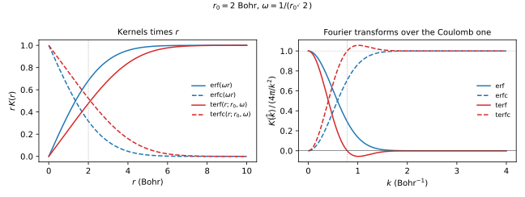

# 4.2 The terf table engine and its far-field fallback

<!-- section: 4.2; status: edit; registry: none;
     theory: crates/ferric-integrals/theory.md#"Kernels in Fourier space", "Two-center integrals over the terf kernel" -->

libint2 has no terf kernel, so ferric evaluates terf and terfc integrals with
its own McMurchie–Davidson driver. The driver is the Coulomb one with the Boys
function replaced by a two-variable auxiliary function $G_m(S, s)$, read from
tables, a series or a tail form depending on where $(S, s)$ falls. This
section derives $G_m$ from the kernel, shows that the code's series is that
function, and states when each evaluation route is taken. Section 4.1 defines
the kernels and the curvature constraint.

| Entry point | Location |
|---|---|
| Rust | `Operator::terf`, `Operator::terfc`, `Operator::terfc_with_omega` in `ferric-integrals/src/operator.rs::Operator`; every `Engine` constructor dispatches them to the table engine (`ferric-integrals/src/engine.rs::is_table_engine`) |
| C++ | `crates/ferric-integrals/shim/shim.cc`: `terf_aux`, `terf_G_series`, `terf_G_tail`, `terf_delta`, `terf_far_field` |
| Tables | `terf-tables/*.bin`, located by `FERRIC_TERF_TABLE_DIR` |
| Optional | a libint2-native terf route behind the `libint2_terf` feature (`ferric-integrals/src/engine.rs::new_terf_libint2`) |

## 4.2.1 The kernels in Fourier space

<!-- include: crates/ferric-integrals/theory.md#"Kernels in Fourier space" -->

> **Verified equation 4.1** · Fourier transforms of the short-range kernels
>
> $\hat K_{\mathrm{terfc}}(k) = (4\pi/k^2)\,(1 - \cos(kr_0)e^{-k^2/4\omega^2})$, and
> the erfc row of the table, agree with a direct radial quadrature of
> $(4\pi/k)\int_0^\infty rK(r)\sin(kr)\,dr$.
>
> | | |
> |---|---|
> | Proof | `scripts/screening_bounds_sympy.py`, claim fourier |
> | Negative control | the transform with $+\cos$ must fail (recorded mutation) |
> | Runner | `crates/ferric-python/tests/test_derivation_scripts.py` |
> | Code | `ferric-integrals/src/schwarz.rs::check_operator_supported` (the transforms are the reason terfc is admitted and terf refused) |
>
> <!-- verified: id=operators.terf.fourier; script=scripts/screening_bounds_sympy.py; claim=fourier; runner=crates/ferric-python/tests/test_derivation_scripts.py; code=ferric-integrals/src/schwarz.rs::check_operator_supported -->

## 4.2.2 The two-center integral and the auxiliary function

<!-- include: crates/ferric-integrals/theory.md#"Two-center integrals over the terf kernel" -->

> **Verified equation 4.2** · the $s$-$s$ terf integral is the kernel at sharpness $\phi$
>
> For $s$ Gaussians of exponents $p$, $q$ at distance $R$,
> $(a|\operatorname{terf}|b) = \frac{2\pi^{5/2}}{pq\sqrt{p+q}}\frac{\phi}{\theta}G_0(S, s)$
> with the closed form of $G_0$ above.
>
> | | |
> |---|---|
> | Proof | `scripts/terf_identities_sympy.py`, claim two-center (closed form against a 30-digit quadrature of the defining six-dimensional integral, reduced to one radial integral) |
> | Negative control | $\operatorname{erf}(\sqrt S - \sqrt s) \to \operatorname{erf}(\sqrt s - \sqrt S)$ and dropping $\phi/\theta$ must fail (recorded mutations) |
> | Runner | `crates/ferric-python/tests/test_derivation_scripts.py` |
> | Code | `ferric-integrals/src/engine.rs::is_table_engine`; `terf_aux` in `crates/ferric-integrals/shim/shim.cc` |
> | Code test | `crates/ferric-integrals/tests/validation_terfc_integrals.rs` (against an independent Fourier-space construction) |
>
> <!-- verified: id=operators.terf.two-center; script=scripts/terf_identities_sympy.py; claim=two-center; runner=crates/ferric-python/tests/test_derivation_scripts.py; code=ferric-integrals/src/engine.rs::is_table_engine; rust_test=ferric-integrals/tests/validation_terfc_integrals.rs::terfc_integrals_h2o_cc_pvdz_vs_kspace -->

> **Verified equation 4.3** · the code's Poisson series is $(-\partial_S)^m G_0$
>
> The series of `terf_G_series` equals the $m$-th $S$-derivative of the
> closed form, its derivative in $R$ has the Boys shape, it reduces to $F_m$
> at $s = 0$, and it splits exactly as $F_m - \Delta_m$.
>
> | | |
> |---|---|
> | Proof | `scripts/terf_identities_sympy.py`, claims series, boys-shape, s-zero, tail-form |
> | Negative control | the double-factorial ratio $(2i)/(2i+1) \to (2i+1)/(2i+2)$ must fail (recorded mutation) |
> | Runner | `crates/ferric-python/tests/test_derivation_scripts.py` |
> | Code | `ferric-integrals/src/engine.rs::is_table_engine`; `terf_G_series`, `terf_G_tail` in `crates/ferric-integrals/shim/shim.cc` |
> | Code test | `crates/ferric-integrals/tests/terfc_series_anchors.rs` ($G_m(S, 0) = F_m$; mpmath anchors) |
>
> <!-- verified: id=operators.terf.series; script=scripts/terf_identities_sympy.py; claim=series; runner=crates/ferric-python/tests/test_derivation_scripts.py; code=ferric-integrals/src/engine.rs::is_table_engine; rust_test=ferric-integrals/tests/terfc_series_anchors.rs::series_g_at_s_zero_equals_boys_s25 -->

> **Verified equation 4.4** · far field and the range of $s$
>
> $G_m = F_m(S)$ to $10^{-12}$ relative where the shim takes the far-field
> branch ($S > 50$ and $\sqrt S - \sqrt s > 6$), and not at points that pass
> only the first test; $s \le (\omega r_0)^2$, so $s < 1/2$ under the
> curvature constraint.
>
> | | |
> |---|---|
> | Proof | `scripts/terf_identities_sympy.py`, claims far-field, s-bound |
> | Runner | `crates/ferric-python/tests/test_derivation_scripts.py` |
> | Code | `ferric-integrals/src/engine.rs::is_table_engine`; `terf_far_field` in `crates/ferric-integrals/shim/shim.cc` |
> | Code test | `crates/ferric-integrals/tests/terf_asymptotic_crossover.rs` |
>
> <!-- verified: id=operators.terf.far-field; script=scripts/terf_identities_sympy.py; claim=far-field; runner=crates/ferric-python/tests/test_derivation_scripts.py; code=ferric-integrals/src/engine.rs::is_table_engine; rust_test=ferric-integrals/tests/terf_asymptotic_crossover.rs::asymptotic_matches_the_exact_series_at_the_crossover -->

## 4.2.3 Evaluation routes

| Region | Route | Shim function |
|---|---|---|
| $S > 50$ and $\sqrt S - \sqrt s > 6$ | $G_m = F_m(S)$ | `terf_far_field` |
| inside a table ($S \le 20$, $s \le 80$) | $10 \times 10$ Lagrange interpolation in the finest covering table | `terf_aux` |
| elsewhere | $F_m(S) - \Delta_m(S, s)$, summed to `terf_tail_index(s)` | `terf_G_tail`, `terf_delta` |
| reference only | the defining series | `terf_G_series` |

The second far-field test matters only when $\omega$ is chosen apart from
$r_0$ (`Operator::terfc_with_omega`). Under the curvature constraint every
pair with $S > 50$ already has $\sqrt S - \sqrt s > 6.36$, and the branch is
the same as with the first test alone.

## 4.2.4 Refusals

| Condition | Result |
|---|---|
| tables not found | engine construction errors; nothing falls back to Coulomb |
| total angular momentum reaches the table depth (24) | the `_checked` calls return the refusal |
| terf in a Schwarz or CSB table | refused (section 5.1) |

## 4.2.5 Numerical anchors

| What | Test | Bar |
|---|---|---|
| terf and terfc $(P\vert\mu\nu)$, $(P\vert Q)$ against a Fourier-space construction sharing nothing with the MD driver (H2O, NH3 / cc-pVDZ; H2O / aug-cc-pVDZ; $r_0$ = 0.75 and 1.05 Å) | `crates/ferric-integrals/tests/validation_terfc_integrals.rs` | $2\times10^{-12}$ (3-index), $3\times10^{-11}$ (2-index) |
| tail form against the series | `crates/ferric-integrals/tests/terf_tail_form.rs` | $10^{-9}$ relative on $\Delta_m$ |
| far field against the series at the crossover | `crates/ferric-integrals/tests/terf_asymptotic_crossover.rs` | $10^{-4}$ over a sweep that includes $S = 25$ |
| $G_m(S, 0) = F_m(S)$ | `crates/ferric-integrals/tests/terfc_series_anchors.rs` | per test |

## Sources

- A. D. Dutoi and M. Head-Gordon, *J. Phys. Chem. A* **112**, 2110 (2008).
- M. Goldey, PhD dissertation, University of California, Berkeley (2014),
  chapter 4.
- L. E. McMurchie and E. R. Davidson, *J. Comput. Phys.* **26**, 218 (1978).
