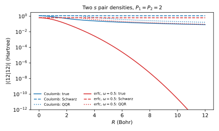

# 5.1 Schwarz bounds, and why they do not see attenuation

<!-- section: 5.1; status: edit; registry: none;
     theory: crates/ferric-integrals/theory.md#"The Schwarz bound", "The combined Schwarz bound (CSB)" -->

Take the integral $(\mu\nu|\lambda\sigma)$ and ask how large it can be
without computing it. Each side is a charge cloud. The cloud
$\chi_\mu\chi_\nu$ is small when $\chi_\mu$ and $\chi_\nu$ barely overlap, and
then its repulsion with anything is small too. The Schwarz inequality turns
this into a number: it bounds a four-center integral by the product of two
diagonal integrals, one per cloud, each measuring how large that cloud is.
A table of $N^2$ diagonals then bounds all $N^4$ integrals. This bound is the
screen behind direct J and K, LinK and the three-index tensors.

The plan:

1. Derive the bound from the Cauchy–Schwarz inequality, and find which
   kernels it holds for.
2. Build the table so that it never falls below an integral.
3. Show why erfc and terfc factors screen almost exactly as Coulomb ones do.
4. Add the combined Schwarz bound (CSB), which needs a weaker condition on
   the kernel.

| Entry point | Location |
|---|---|
| Rust, tables | `ferric-integrals/src/schwarz.rs::{schwarz,schwarz3_aux,bound_inflation,check_operator_supported}` |
| Rust, the bound trait | `ferric-scf/src/screening.rs::{Bound,SchwarzBounds,CsbBounds}` |
| Rust, CSB | `ferric-integrals/src/csb.rs::csb_m_table` |
| terfc validity box | `ferric-integrals/src/schwarz.rs::check_terfc_parameters_validated` |

## 5.1.1 The bound and the admitted kernels

### Cauchy–Schwarz on the two-electron form

Write the two-electron integral as a bilinear form on charge distributions:

$$ (f|\hat w|g) = \iint f(\mathbf r_1)\, w(r_{12})\, g(\mathbf r_2)\, d\mathbf r_1\, d\mathbf r_2 . $$

It is symmetric in $f$ and $g$. Suppose the kernel is positive definite:
$(\rho|\hat w|\rho) > 0$ for every nonzero $\rho$. Then the form is an inner
product on charge distributions, and the Cauchy–Schwarz inequality holds.
To derive it, expand the self-interaction of $f + tg$ for a real number $t$:

$$ 0 \le (f + tg|\hat w|f + tg) = (f|\hat w|f) + 2t\,(f|\hat w|g) + t^2\,(g|\hat w|g) . $$

A quadratic in $t$ that is never negative has a discriminant that is not
positive, so $(f|\hat w|g)^2 \le (f|\hat w|f)\,(g|\hat w|g)$. Substitute
$f = \chi_\mu\chi_\nu$ and $g = \chi_\lambda\chi_\sigma$ and take the square
root:

$$ |(\mu\nu|\hat w|\lambda\sigma)| \le Q_{\mu\nu} Q_{\lambda\sigma}, \qquad Q_{\mu\nu} = (\mu\nu|\hat w|\mu\nu)^{1/2} . $$

Check the diagonal: with $\lambda\sigma = \mu\nu$ both sides equal
$(\mu\nu|\mu\nu)$, so the bound is exact there.

Every step used positive definiteness. Without it $(\rho|\hat w|\rho)$ can be
negative, $Q$ is not a real number, and the discriminant argument fails.

### Which kernels are positive definite

The self-interaction is easiest to judge in Fourier space. With
$\tilde\rho(\mathbf k) = \int \rho(\mathbf r)\,e^{-i\mathbf k\cdot\mathbf r}\,d\mathbf r$
and $\hat K(k)$ the transform of the kernel, the convolution theorem gives

$$ (\rho|\hat w|\rho) = \frac{1}{(2\pi)^3}\int |\tilde\rho(\mathbf k)|^2\,\hat K(k)\, d\mathbf k . $$

Check it on a unit-charge $s$ Gaussian of exponent $a$ under Coulomb:
$\tilde\rho = e^{-k^2/4a}$ and $\hat K = 4\pi/k^2$, so the integral is
$(2/\pi)\int_0^\infty e^{-k^2/2a}\,dk = \sqrt{2a/\pi}$. That is the closed
form $2\theta/\sqrt\pi$ with $\theta^2 = a/2$ used below.

If $\hat K(k) > 0$ for every $k > 0$, the integrand is non-negative and the
self-interaction of a nonzero $\rho$ is positive. Bochner's theorem gives the
converse: a kernel is positive definite exactly when $\hat K(k) > 0$ for
$k > 0$. Section 4.1.3 tabulates the transforms. Coulomb, erf, erfc and terfc
qualify. terf does not: its transform is
$(4\pi/k^2)\cos(kr_0)\,e^{-k^2/4\omega^2}$, which is negative for
$kr_0 \in (\pi/2, 3\pi/2)$ and periodically beyond, with its first zero at
$kr_0 = \pi/2$. A charge distribution modulated near that wavevector has a
negative self-interaction through terf, and its "$Q$" is not real.

terfc is positive definite for every $(r_0, \omega)$. Its transform is
$(4\pi/k^2)\big(1 - \cos(kr_0)\,e^{-k^2/4\omega^2}\big)$, and replacing
$\cos(kr_0)$ by its maximum value $1$ gives the lower bound

$$ \hat K_{\mathrm{terfc}}(k) \ge \frac{4\pi}{k^2}\big(1 - e^{-k^2/4\omega^2}\big) > 0 . $$

Where $\cos(kr_0) < 0$ the terfc transform exceeds the Coulomb one,
$4\pi/k^2$. So $\operatorname{terfc}(r) \le 1$ pointwise does not make
$(\rho|\operatorname{terfc}|\rho) \le (\rho|1/r|\rho)$: a Coulomb diagonal is
not a substitute for a terfc one. The comment on the terfc arm of
`check_operator_supported` records that the Coulomb diagonal undershoots by
up to 26%.

Ferric's table builder accepts Coulomb, erf, erfc and terfc and refuses terf
as invalid. Here is the operator match of
`ferric-integrals/src/schwarz.rs::check_operator_supported`, with the comments
removed, the error string shortened and the fallback arm left out:

```rust
OperatorKind::Coulomb | OperatorKind::ErfCoulomb | OperatorKind::ErfcCoulomb => {}
OperatorKind::Terf => {
    return Err(FerricError::Libint(
        "Schwarz screening is INVALID for the Terf operator, not merely unimplemented: \
         ... Measured: min (P|P)_terf = -7.543e-3 on water/cc-pVDZ at r0=2. ..."
            .to_string(),
    ))
}
OperatorKind::Terfc => check_terfc_validated_range(op, prep)?,  // the validity box, 5.1.2
```

No implementation work would make terf admissible, because the inequality
itself fails. The full message names the alternative: RI/DF for the
long-range piece. terf integrals do not decay with separation, so a distance
screen would find little to discard in any case.

> **Verified equation 5.1** · terf is not positive definite
>
> $\hat K_{\mathrm{terf}}$ is negative on $kr_0 \in (\pi/2, 3\pi/2)$, with its first
> zero at $kr_0 = \pi/2$. On $s$ Gaussians on one centre the terf Gram matrix has
> a negative eigenvalue, while erfc and terfc stay positive on the same set,
> and a terf integral exceeds its "Schwarz bound" outright.
>
> | | |
> |---|---|
> | Proof | `scripts/screening_bounds_sympy.py`, claims sign and indefinite |
> | Negative control | dropping the $e^{-\phi^2r_0^2}$ factor of the same-centre terf integral must fail (recorded mutation) |
> | Runner | `crates/ferric-python/tests/test_derivation_scripts.py` |
> | Code | `ferric-integrals/src/schwarz.rs::check_operator_supported` |
> | Code test | `crates/ferric-integrals/tests/operator_positivity_gate.rs` |
>
> <!-- verified: id=screening.terf-indefinite; script=scripts/screening_bounds_sympy.py; claim=indefinite; runner=crates/ferric-python/tests/test_derivation_scripts.py; code=ferric-integrals/src/schwarz.rs::check_operator_supported; rust_test=ferric-integrals/tests/operator_positivity_gate.rs::positive_definite_operators_have_nonnegative_diagonals -->

### From functions to shells

The code screens whole shell quartets. The shell-pair factor is the largest
function-level factor in the pair,

$$ Q(s_1, s_2) = \max_{\mu \in s_1,\, \nu \in s_2} |(\mu\nu|\mu\nu)|^{1/2}, $$

so $|(\mu\nu|\lambda\sigma)| \le Q_{\mu\nu}Q_{\lambda\sigma} \le Q(s_1,s_2)\,Q(s_3,s_4)$
for every element of the block $(s_1 s_2|s_3 s_4)$
(`ferric-integrals/src/schwarz.rs::schwarz`). Three-index integrals follow
from the same inequality, with the auxiliary function $\chi_P$ as one of the
two charge distributions:

$$ |(P|\mu\nu)| \le Q_3(P)\, Q(\mu,\nu), \qquad Q_3(P) = \max_a |(P_a|P_a)|^{1/2}, $$

where $a$ runs over the functions of auxiliary shell $P$
(`ferric-integrals/src/schwarz.rs::schwarz3_aux`).

### Why Schwarz does not see attenuation

$Q_{\mu\nu}$ is the self-interaction of one pair density. It does not depend
on where the other pair is, so the Schwarz product of two pairs is the same at
every separation. For Coulomb this costs little, since a Coulomb integral
falls only as $1/R$. For a short-range kernel the integral falls much faster,
and the bound does not follow it.

Take a primitive $s$ pair density of exponent $P$ and charge $q$. Its
self-interactions are closed forms (`scripts/screening_bounds_sympy.py`):

$$ (\rho|1/r|\rho) = q^2\,\frac{2\theta}{\sqrt\pi}, \quad \theta^2 = \frac P2, \qquad (\rho|\operatorname{erf}|\rho) = q^2\,\frac{2\phi}{\sqrt\pi}, \quad \phi^2 = \frac{1}{2/P + 1/\omega^2} . $$

The erfc kernel is Coulomb minus erf. Subtract and divide by the Coulomb
value:

$$ \frac{Q^2_{\mathrm{erfc}}}{Q^2_{\mathrm{Coulomb}}} = 1 - \frac{\phi}{\theta} \;\longrightarrow\; 1 \quad (P/\omega^2 \to \infty) . $$

Check both ends. A compact pair ($P/\omega^2 \to \infty$) has $\phi \to \omega$
while $\theta$ grows without limit, so the ratio goes to $1$: the pair is not
attenuated at all in its own factor. A diffuse pair has $P/\omega^2 \to 0$;
write $x = P/\omega^2$, so that $\phi/\theta = \sqrt{2/(2 + x)}$ and the ratio
is $x/4 + O(x^2)$, which goes to $0$. Attenuation reaches a factor only for
pairs wider than about $1/\omega$.

Now compare the true integral. Between two separated $s$ densities, the
Coulomb integral is $q_1q_2\operatorname{erf}(\theta R)/R$ with
$\theta^2 = P_1P_2/(P_1 + P_2)$, and the erf integral is
$q_1q_2\operatorname{erf}(\phi R)/R$ with
$\phi^2 = 1/(1/P_1 + 1/P_2 + 1/\omega^2)$. Subtract:

$$ (12|\operatorname{erfc}|12) = q_1q_2\,\frac{\operatorname{erfc}(\phi R) - \operatorname{erfc}(\theta R)}{R} . $$

Since $\phi < \theta$, the first term dominates at large $R$, and the
integral decays like $\operatorname{erfc}(\phi R)/R$, a Gaussian in $R$. No
factor of the bound does. The verification script puts numbers on it: for two
compact pairs ($P = 20$) at $R = 8/\omega$ the true erfc integral is below
$10^{-12}$ of its Schwarz bound. The attenuation reaches the bound only
through the per-pair factors, so erfc and terfc screen almost the same set of
quartets as Coulomb.

> **Verified equation 5.2** · Schwarz holds for erf, erfc and terfc, and does not see attenuation
>
> On random $s$ quartets $|(ab|cd)| \le Q_{ab}Q_{cd}$ for erf, erfc and terfc.
> $Q^2_{\mathrm{erfc}}/Q^2_{\mathrm{Coulomb}} = 1 - \phi/\theta \to 1$ for compact
> pairs, and the bound is independent of the distance between the pairs while
> the true erfc integral decays.
>
> | | |
> |---|---|
> | Proof | `scripts/screening_bounds_sympy.py`, claims schwarz and blind |
> | Negative control | $Q$ without the square root must fail (recorded mutation) |
> | Runner | `crates/ferric-python/tests/test_derivation_scripts.py` |
> | Code | `ferric-integrals/src/schwarz.rs::schwarz` |
> | Code test | `crates/ferric-integrals/tests/terfc_schwarz_screening.rs` (terfc never undershoots, with $d$ shells, diffuse shells and quartets; mutants caught) |
>
> <!-- verified: id=screening.schwarz-blind; script=scripts/screening_bounds_sympy.py; claim=blind; runner=crates/ferric-python/tests/test_derivation_scripts.py; code=ferric-integrals/src/schwarz.rs::schwarz; rust_test=ferric-integrals/tests/terfc_schwarz_screening.rs::terfc_schwarz_never_undershoots_quartets -->

The figure plots the same closed forms against distance for two unit-charge
$s$ pairs with $P_1 = P_2 = 2$ Bohr$^{-2}$, at $\omega = 0.5$ Bohr$^{-1}$ for
erfc. The erfc Schwarz bound is a flat line while the integral falls by many
orders.



## 5.1.2 Building a table that never undershoots

A Schwarz table is only safe if every entry is at least the true diagonal.
Two things in an integral engine can break that. Libint2 skips a quartet whose
estimated magnitude is below the engine precision and returns no block
(section 3.2.2); a skipped diagonal would be stored as $Q = 0$. And the terfc
engine interpolates tables, so a diagonal can come out slightly low. The
table builder guards against both. This is
`ferric-integrals/src/schwarz.rs::schwarz_pair`, with the error message
shortened:

```rust
let maxv = match eng.compute_quartet_checked(prep, i, j, i, j) {
    Ok(Some(block)) => diagonal_max(block, n1, n2), // max_{a,b} |(ab|ab)| over the pair
    Ok(None) => 0.0,                                // screened: the floor below applies
    Err(status) => {
        return Err(FerricError::Libint(format!(/* .. */))) // refused: no bound exists
    }
};
// `scale` is exactly 1.0 for every table-free operator (x * 1.0 is
// bit-identical); see `bound_inflation` for the terfc value.
Ok((maxv.sqrt() * scale).max(SCHWARZ_Q_FLOOR))     // Q = scale * sqrt(max), at least 1e-100
```

Three points about it:

- **The engine was built at precision 0.** `schwarz` constructs it with
  `SCHWARZ_TABLE_PRECISION`, which disables libint2's own skip, so the
  `Ok(None)` arm should not occur for a nonzero diagonal. The floor covers a
  diagonal that is zero or underflows.
- **A refusal is an error.** A table engine can refuse a quartet (total
  angular momentum past the table depth). Nothing is then known about the
  block, and storing the floor would silently skip every quartet on the
  pair.
- **`diagonal_max` reads a generalized diagonal.** The block $(ij|ij)$ has
  $n_1 n_2 n_1 n_2$ elements, and $(ab|ab)$ sits at flat index
  `((a*n2 + b)*n1 + a)*n2 + b`.

The choices, with their reasons:

| Choice | Value | Why |
|---|---|---|
| engine precision for the diagonals | $0$ (`SCHWARZ_TABLE_PRECISION`) | libint2's own skip would return no block for a small diagonal |
| floor on every factor | $10^{-100}$ (`SCHWARZ_Q_FLOOR`) | a zero factor would make a threshold-$0$ screen drop pairs |
| terfc factors | $\times(1 + 10^{-5})$ (`bound_inflation`) | the table engine is interpolated; the margin is empirical |
| terfc parameters | $r_0 \in [0.3, 2.5]$ Å, $0 < r_0\omega \le 8.9$, $l \le 4$ | the box the margin was measured in; outside it the call is refused |
| shell-pair factor | the largest $\lvert(\mu\nu\vert\mu\nu)\rvert^{1/2}$ over the pair's functions | an element-wise bound for every function in the block |

Why does a zero factor matter at threshold $0$? The screens compare
`estimate > threshold`. With a zero factor the estimate is zero, and
$0 > 0$ is false, so the pair is dropped at every threshold, including $0$.
The floor $10^{-100}$ squares to $10^{-200}$, far below any threshold anyone
enforces, so it never keeps a negligible quartet alive in a real screen, and
it makes `estimate > 0` true everywhere. Then threshold $0$ keeps every pair,
and a screened build equals the unscreened one
(`crates/ferric-scf/tests/screening_exactness.rs`,
`crates/ferric-scf/tests/eri_precision_matches_unscreened.rs`). That is the
trivial limit of the screen. The table is built at precision $0$ instead of
at some multiple of the screening threshold so that it does not depend on a
threshold the caller can change.

Why $1 + 10^{-5}$ for terfc? If the engine returns a diagonal low by a
relative $\delta$, its factor is low by $1 - \sqrt{1 - \delta} \approx \delta/2$.
A bound that undershoots by a relative $\delta$ screens like an exact bound
at threshold $\tau(1 + \delta)$, to first order, so a small undershoot moves
only quartets that sit at the threshold. The margin is measured, not
derived from the table error (`ferric-integrals/src/schwarz.rs::TERFC_TABLE_Q_INFLATION`
documents the measurement), and `check_terfc_parameters_validated` refuses
any $(r_0, \omega)$ outside the box it was measured in, with a message that
names `schwarz_skip = 0.0` as the way to run without the bound.

## 5.1.3 The combined Schwarz bound

Schwarz pairs the bra with the ket: $\chi_\mu\chi_\nu$ against
$\chi_\lambda\chi_\sigma$. If the kernel is positive pointwise,
$w(r) > 0$ for $r > 0$, the same integral can be split the other way. Regroup
the four functions by electron coordinate, with
$F = \chi_\mu(1)\chi_\lambda(2)$ and $G = \chi_\nu(1)\chi_\sigma(2)$:

$$ (\mu\nu|\lambda\sigma) = \iint F(\mathbf r_1, \mathbf r_2)\, G(\mathbf r_1, \mathbf r_2)\, w(r_{12})\, d\mathbf r_1\, d\mathbf r_2 . $$

This is an inner product of $F$ and $G$ on $L^2(\mathbb R^6, w)$, the
functions of both electrons' coordinates weighted by $w(r_{12})$. It is an
inner product whenever $w \ge 0$; no Fourier condition is needed. Apply
Cauchy–Schwarz to it. The self-product of $F$ is
$\iint \chi_\mu(1)^2\, w(r_{12})\, \chi_\lambda(2)^2 = (\mu\mu|\lambda\lambda)$,
and that of $G$ is $(\nu\nu|\sigma\sigma)$. Swapping $\lambda$ and $\sigma$
(the integral is symmetric under it) gives a second bound. Take the minimum
with Schwarz (Thompson and Ochsenfeld, *J. Chem. Phys.* **147**, 144101
(2017), Eqs. 6 to 8):

$$ |(\mu\nu|\lambda\sigma)| \le \min\big\{ Q_{\mu\nu}Q_{\lambda\sigma},\; M_{\mu\lambda}M_{\nu\sigma},\; M_{\mu\sigma}M_{\nu\lambda} \big\}, \qquad M_{\mu\lambda} = (\mu\mu|\lambda\lambda)^{1/2} . $$

$M_{\mu\lambda}$ is the repulsion between the densities of $\chi_\mu$ and
$\chi_\lambda$, so it depends on the distance between $\mu$ and $\lambda$,
which $Q$ does not (`ferric-integrals/src/csb.rs::csb_m_table`). That is where
CSB gets its distance dependence.

Check the two diagonal cases. On $(\mu\nu|\mu\nu)$ the $QQ$ term is exact. On
$(\mu\mu|\nu\nu)$ the term $M_{\mu\nu}M_{\mu\nu} = (\mu\mu|\nu\nu)$ is exact.

The $M$ terms need pointwise positivity, not positive definiteness. So
$M_{\mu\lambda}M_{\nu\sigma}$ bounds terf integrals too, since
$\operatorname{terf}(r) \ge 0$ for $r \ge 0$. But the full CSB minimum
contains $Q_{\mu\nu}Q_{\lambda\sigma}$, which needs positive definiteness, and
is invalid for terf.

| Kernel | $QQ$ term | $MM$ terms | `csb_m_table` |
|---|---|---|---|
| Coulomb, erf, erfc | valid | valid | built |
| terfc | valid | valid | refused: no interpolation-error budget yet |
| terf | invalid | valid | refused |

> **Verified equation 5.3** · the $MM$ terms need only $w \ge 0$
>
> $\operatorname{terf}(r) \ge 0$ for $r \ge 0$, and
> $|(ab|cd)| \le \min(M_{ac}M_{bd}, M_{ad}M_{bc})$ holds on random terf and terfc
> $s$ quartets, although terf violates Schwarz.
>
> | | |
> |---|---|
> | Proof | `scripts/screening_bounds_sympy.py`, claim csb |
> | Runner | `crates/ferric-python/tests/test_derivation_scripts.py` |
> | Code | `ferric-integrals/src/csb.rs::csb_m_table` |
> | Code test | `crates/ferric-scf/tests/csb_screening.rs` (Coulomb and erfc: valid, never looser than Schwarz, trivial limit) |
>
> <!-- verified: id=screening.csb-pointwise; script=scripts/screening_bounds_sympy.py; claim=csb; runner=crates/ferric-python/tests/test_derivation_scripts.py; code=ferric-integrals/src/csb.rs::csb_m_table; rust_test=ferric-scf/tests/csb_screening.rs::csb_is_a_valid_upper_bound -->

The code refuses CSB for terf with the reason that the $M$ terms "come from
the same Cauchy–Schwarz argument as Schwarz" and so need positive
definiteness. The refusal is right, because the full minimum contains the
$QQ$ term; the stated reason is stronger than the derivation above needs. An
$MM$-only bound would be valid for terf.

### The code

`csb_m_table` builds $M$ the way `schwarz` builds $Q$: one $(PP|QQ)$ quartet
per unordered shell pair, at `SCHWARZ_TABLE_PRECISION`, keeping the largest
$|(\mu\mu|\lambda\lambda)|$ over $\mu \in P$, $\lambda \in Q$, with the floor
`SCHWARZ_Q_FLOOR`. The bound itself is
`ferric-scf/src/screening.rs::CsbBounds`'s `estimate`, unchanged apart from
the comments:

```rust
fn estimate(&self, sh1: usize, sh2: usize, sh3: usize, sh4: usize) -> f64 {
    let schwarz_est = self.schwarz.estimate(sh1, sh2, sh3, sh4); // Q_{12} Q_{34}
    let eq6 = self.m[(sh1, sh3)] * self.m[(sh2, sh4)];           // M_{mu lambda} M_{nu sigma}
    let eq7 = self.m[(sh1, sh4)] * self.m[(sh2, sh3)];           // M_{mu sigma} M_{nu lambda}
    schwarz_est.min(eq6).min(eq7)
}
```

Two points about it:

- **The chain starts from Schwarz.** Whatever the $M$ table holds, the
  result is never above the Schwarz product. A defect in `csb_m_table`
  therefore cannot loosen the bound. It can still make the bound too small,
  through a spuriously small $M$; `csb_is_a_valid_upper_bound` in
  `crates/ferric-scf/tests/csb_screening.rs` tests that direction.
- **CSB cannot shrink a pair list.** Section 5.3's pair lists are built from
  diagonal estimates $(ij|ij)$. There the Schwarz term $Q(i,j)^2$ equals the
  largest $|(ab|ab)|$ in the block, and each $M$ term is a valid bound on
  every element of the block, so neither is smaller. The minimum returns the
  Schwarz term, and CSB acts only on per-quartet screens.

The $M$ table comes from the same `Operator` as the $Q$ table:
`CsbBounds::compute` takes one `op` and builds both. Attenuation enters $M$
through the $(\mu\mu|\lambda\lambda)$ integrals themselves, as it enters $Q$
through $(\mu\nu|\mu\nu)$. There is no separate geometric factor that could
count it twice.

## 5.1.4 Numerical anchors

| What | Test | Bar |
|---|---|---|
| terfc Schwarz never undershoots a true $(P\vert ab)$ or quartet over the validated box (methane, water; cc-pVDZ to def2-QZVP) | `crates/ferric-integrals/tests/terfc_schwarz_screening.rs` | bound/true $\ge 1$ |
| a halved bound and the Coulomb-diagonal substitute are caught | same file, `mutants_are_caught_by_the_validity_check` | must fail |
| terfc quartet bound on water / cc-pVDZ | `crates/ferric-integrals/tests/eri4_terfc_schwarz_validity.rs` | bound/true $\ge 1$ |
| positive-definite kernels have nonnegative diagonals; terf does not | `crates/ferric-integrals/tests/operator_positivity_gate.rs` | sign |
| CSB valid, never looser than Schwarz, equal to it in the trivial limit, RHF energy unchanged | `crates/ferric-scf/tests/csb_screening.rs` | per test |

The Cauchy–Schwarz derivation, the Fourier form of the self-interaction and
the diffuse-pair limit $x/4$ in 5.1.1 are not claims of the verification
script; they were checked with sympy for this section. The function-to-shell
step is the definition of a maximum.

## Sources

- M. Häser and R. Ahlrichs, *J. Comput. Chem.* **10**, 104 (1989).
- T. H. Thompson and C. Ochsenfeld, *J. Chem. Phys.* **147**, 144101 (2017).
- S. Bochner, *Math. Ann.* **108**, 378 (1933).
