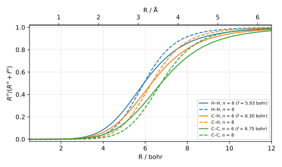

# 25.1 D3(BJ): energy, coordination numbers, gradient, three-body term

<!-- section: 25.1; status: ready; registry: d3;
     theory: crates/ferric-d3/theory.md#"Gradient" -->

Grimme's D3 adds a damped $-C_6/R^6 - C_8/R^8$ sum over atom pairs to a
Kohn–Sham energy. Its $C_6$ is not a constant: it is interpolated from
tabulated reference values by each atom's coordination number, so the
geometry enters twice, through the distances and through the coefficients.
ferric implements Becke–Johnson (rational) damping and the optional
Axilrod–Teller–Muto (ATM) three-body term, with the parameters of
simple-dftd3 1.6.0. Zero damping and periodic cells are not implemented.

| Symbol | Meaning | Code name |
|---|---|---|
| $A, B, C$ | atoms (ghosts removed) | `i`, `j`, `k` |
| $i, j$ | reference systems of an element | `iref`, `jref` |
| $R_{AB}$ | interatomic distance, Bohr | `r` |
| $\mathrm{CN}_A$ | coordination number | `cn[i]` |
| $s_6, s_8, a_1, a_2, s_9$ | functional parameters | `D3Params::{s6,s8,a1,a2,s9}` |

| Entry point | Location |
|---|---|
| Rust | `ferric-d3/src/lib.rs::{d3bj_energy,d3bj_gradient}`, `ferric-d3/src/lib.rs::{d3bj_energy_for_molecule,d3bj_gradient_for_molecule}`, `ferric-d3/src/params.rs::d3bj_params_for_functional` |
| CLI | `[dft] dispersion = "d3bj"` (the running functional's parameters) or `"d3bj(<name>)"`, on `ksdft`, `uhf` and `rohf` with a functional; energy, optimize and frequencies |
| Python | `run_dft(dispersion="d3bj")`, `run_frequencies(xc=..., dispersion="d3bj")`, `d3bj_energy(mol, functional, s9=0.0)` |

## 25.1.1 Coordination numbers and the interpolated $C_6$

For $A \ne B$,

$$ g_{AB}(R) = \Big[1 + e^{-k\,(R^{\mathrm{cov}}_{AB}/R - 1)}\Big]^{-1}, \qquad \mathrm{CN}_A = \sum_{B\ne A} g_{AB}(R_{AB}), \tag{25.1} $$

with $k = 16$ (`KCN`), $R^{\mathrm{cov}}_{AB} = R^{\mathrm{cov}}_A + R^{\mathrm{cov}}_B$
and $R^{\mathrm{cov}}_A$ the 2009 covalent radius scaled by 4/3 (`rcov`).
Each pair term $g_{AB}$ appears in both $\mathrm{CN}_A$ and $\mathrm{CN}_B$.

Element $A$ has reference systems $i$ with coordination numbers
$\mathrm{CN}^{\mathrm{ref}}_{A,i}$. With Gaussian weights
$W_{A,i} = \exp[-w_f(\mathrm{CN}_A - \mathrm{CN}^{\mathrm{ref}}_{A,i})^2]$,
$w_f = 4$ (`WF`),

$$ C_6^{AB} = \frac{\sum_{ij} C_6^{\mathrm{ref}}(A_i, B_j)\,W_{A,i}W_{B,j}}{\sum_{ij} W_{A,i}W_{B,j}} . \tag{25.2} $$

When every weight underflows (denominator $\le 10^{-300}$) `c6_interpolated`
uses the nearest reference on each side; that branch is piecewise constant and
`c6_interpolated_derivatives` returns zero for it.

## 25.1.2 The BJ energy

$$ Q_A = \tfrac12\sqrt{Z_A}\,\frac{\langle r^4\rangle_A}{\langle r^2\rangle_A},\qquad q_{AB} = \sqrt{Q_AQ_B},\qquad C_8^{AB} = 3\,C_6^{AB}q_{AB}, \tag{25.3} $$

$$ f_{AB} = a_1\sqrt{C_8^{AB}/C_6^{AB}} + a_2 = a_1\sqrt{3q_{AB}} + a_2, \tag{25.4} $$

$$ E_{\mathrm{D3}} = -\sum_{A<B}\left[\frac{s_6\,C_6^{AB}}{R_{AB}^6 + f_{AB}^6} + \frac{s_8\,C_8^{AB}}{R_{AB}^8 + f_{AB}^8}\right] . \tag{25.5} $$

$C_6$ cancels in $C_8/C_6$, so the damping radius $f_{AB}$ depends only on the
two elements and has no gradient. Figure 25.1 shows the two damping
multipliers for PBE.



## 25.1.3 The gradient

$E_{\mathrm{D3}}$ depends on $\mathbf R_X$ through every $R_{AB}$ and, through
(25.1)–(25.2), through every $C_6^{AB}$ — including pairs that do not contain
$X$. With $d_n = R^n + f^n$,

$$ \frac{dE}{d\mathbf R_X} = \sum_{A<B}\frac{\partial E_{AB}}{\partial R_{AB}}\frac{\partial R_{AB}}{\partial\mathbf R_X} + \sum_{A<B}\Big(\frac{\partial E}{\partial\mathrm{CN}_A} + \frac{\partial E}{\partial\mathrm{CN}_B}\Big)\frac{\partial g_{AB}}{\partial R_{AB}}\frac{\partial R_{AB}}{\partial\mathbf R_X}, \tag{25.6} $$

$$ \frac{\partial E_{AB}}{\partial R} = \frac{6s_6C_6R^5}{d_6^2} + \frac{8s_8C_8R^7}{d_8^2},\qquad \frac{\partial E}{\partial\mathrm{CN}_A} = -\sum_{B\ne A}\Big(\frac{s_6}{d_6} + \frac{3q_{AB}s_8}{d_8}\Big)\frac{\partial C_6^{AB}}{\partial\mathrm{CN}_A},\qquad \frac{\partial g}{\partial R} = -\frac{kR^{\mathrm{cov}}_{AB}}{R^2}\,g(1-g) . $$

The second term of (25.6) is the coordination-number chain rule. Dropping it
gives a gradient with the right magnitude and symmetry that is wrong by a few
percent; only a finite-difference test sees it.

> **Verified equation 25.6** · the D3(BJ) gradient with the CN chain rule
>
> On a four-atom, two-element model with three and two reference
> coordination numbers and the code's $k = 16$, $w_f = 4$, the two-pass
> gradient transcribed from `d3bj_gradient` equals sympy's exact derivative of
> the transcribed energy and a 60-digit central finite difference. With one
> reference per element the chain term vanishes exactly.
>
> | | |
> |---|---|
> | Proof | `scripts/d3_cn_chain_rule_gradient_sympy.py`, claim 5 (and 6 for the anchor) |
> | Negative control | contraction weight with only $\partial E/\partial\mathrm{CN}_A$; $C_8 = C_6q$ |
> | Runner | `crates/ferric-python/tests/test_derivation_scripts.py` |
> | Code | `ferric-d3/src/lib.rs::{d3bj_gradient,c6_interpolated_derivatives}` |
> | Code test | `analytic_gradient_matches_finite_difference` in `crates/ferric-d3/tests/gradient_vs_fd.rs` |
>
> <!-- verified: id=d3.bj.cn-chain-gradient; script=scripts/d3_cn_chain_rule_gradient_sympy.py; claim=5; runner=crates/ferric-python/tests/test_derivation_scripts.py; code=ferric-d3/src/lib.rs::{d3bj_gradient,c6_interpolated_derivatives}; rust_test=ferric-d3/tests/gradient_vs_fd.rs::analytic_gradient_matches_finite_difference; registry=d3 -->

`d3bj_gradient` evaluates (25.6) in two $O(N^2)$ passes: the first adds the
explicit term and banks the $N$ scalars $\partial E/\partial\mathrm{CN}_A$ in
`de_dcn`; the second adds `(de_dcn[i] + de_dcn[j]) * dg_dr` along each pair
axis. The banked scalars need $\partial C_6^{AB}/\partial\mathrm{CN}_A$, the
quotient rule on (25.2):

<!-- excerpt: ferric-d3/src/lib.rs::c6_interpolated_derivatives -->
```rust
let da = -2.0 * WF * (cni - cnref_i) * a;
for (jref, &b) in wj.iter().enumerate() {
    let cnref_j = tables::REFERENCE_CN[jref + tables::MAX_REF * (zj - 1)];
    let db = -2.0 * WF * (cnj - cnref_j) * b;

    let c = reference_c6(iref, jref, zi, zj);
    num += c * a * b;
    den += a * b;
    dnum_i += c * da * b;
    dden_i += da * b;
    dnum_j += c * a * db;
    dden_j += a * db;
}
```

and then `((dnum_i - c6 * dden_i) / den, (dnum_j - c6 * dden_j) / den)`.

| Symbol | Code |
|---|---|
| $W_{A,i}$, $W_{B,j}$ | `a`, `b` |
| $\partial W_{A,i}/\partial\mathrm{CN}_A$ | `da` |
| $C_6^{\mathrm{ref}}(A_i, B_j)$ | `c` |
| numerator, denominator of (25.2) and their CN derivatives | `num`, `den`, `dnum_i`, `dden_i`, `dnum_j`, `dden_j` |

## 25.1.4 The three-body term

With $s_9 \ne 0$ the energy gains, for every triple $A>B>C$ with squared sides
$x = R_{AB}^2$, $y = R_{BC}^2$, $w = R_{AC}^2$ and $P = R_{AB}R_{BC}R_{AC}$,

$$ E_{\mathrm{ATM}} = s_9\sum_{A>B>C}\sqrt{C_6^{AB}C_6^{AC}C_6^{BC}}\;\frac{1}{1 + 6\,(r_0/P)^{\alpha/3}}\;\frac{3\cos\theta_A\cos\theta_B\cos\theta_C + 1}{P^3}, \tag{25.7} $$

with $r_0 = \prod_{\text{sides}} r_sR^{\mathrm{vdW}}_{ab}$, $r_s = 4/3$
(`ATM_RS9`), $\alpha = 16$ (`ATM_ALPHA`), and the same CN-interpolated $C_6$.
The code writes the angular factor through the law of cosines
(`atm_triple_factor`). Its $C_6$ dependence,
$\partial E_{ABC}/\partial C_6^{ab} = E_{ABC}/(2C_6^{ab})$, goes into the same
`de_dcn` before the contraction pass, so one pass carries both chain rules.
The triple sum is $O(N^3)$ with no distance cutoff.

> **Verified equation 25.7** · the ATM factor and its gradient
>
> The law-of-cosines form equals the cosine form; the derivatives with respect
> to $x, y, w$ and $C_6$ are the coded ones; and the Cartesian gradient
> assembled from them equals sympy's direct derivative at a random triangle
> (40 digits).
>
> | | |
> |---|---|
> | Proof | `scripts/d3_atm_gradient_sympy.py`, claim 5 |
> | Negative control | the $15/16$ term dropped; $\alpha/6$ in $\partial f/\partial q$; $\partial E/\partial C_6 = E/C_6$ |
> | Runner | `crates/ferric-python/tests/test_derivation_scripts.py` |
> | Code | `ferric-d3/src/lib.rs::{atm_triple_factor,atm_energy,atm_gradient}` |
> | Code test | `atm_gradient_matches_finite_difference` in `crates/ferric-d3/tests/gradient_vs_fd.rs` |
>
> <!-- verified: id=d3.atm.gradient; script=scripts/d3_atm_gradient_sympy.py; claim=5; runner=crates/ferric-python/tests/test_derivation_scripts.py; code=ferric-d3/src/lib.rs::{atm_triple_factor,atm_energy,atm_gradient}; rust_test=ferric-d3/tests/gradient_vs_fd.rs::atm_gradient_matches_finite_difference; registry=d3 -->

## 25.1.5 The algorithm

| Step | Quantity | Cost | Function |
|---|---|---|---|
| 1 | drop ghost atoms; refuse $Z$ outside the tables, coincident atoms, non-finite coordinates | $N$ | `d3bj_energy_for_molecule`, `checked_numbers` |
| 2 | $\mathrm{CN}_A$ (25.1) | $N^2$ | `coordination_numbers` |
| 3 | per pair: $C_6$ (25.2), $f_{AB}$, energy and explicit gradient; bank $\partial E/\partial\mathrm{CN}$ | $N^2 n_{\mathrm{ref}}^2$ | `c6_interpolated`, `c6_interpolated_derivatives` |
| 4 | if $s_9 \ne 0$: triples (25.7) and their CN terms | $N^3$ | `atm_energy`, `atm_gradient` |
| 5 | contract `de_dcn` with $\partial g/\partial R$ | $N^2$ | `d3bj_gradient` |
| 6 | scatter rows back to the molecule's atom order, ghosts zero | $N$ | `d3bj_gradient_for_molecule` |

Ghost centres carry no nucleus and no density, so they are excluded; ECP
atoms count at their full $Z$, because the reference data are indexed by
element. Fewer than two real atoms give exactly 0, and a molecule of ghosts
only is an error rather than a zero.

## 25.1.6 Options

| Option | Values | Effect |
|---|---|---|
| `[dft] dispersion` | `"d3bj"`, `"d3(bj)"`, `"d3bj(<name>)"` | absent means no correction; there is no "off" value |
| functional | BLYP, BP86, B97-D, PBE, PBE0, revPBE, B3LYP, TPSS, TPSS0, B2PLYP, BHLYP, SCAN, r2SCAN, ωB97X | $(s_6, s_8, a_1, a_2)$ from `params.rs`; M06-2X (zero-damping fit only) and any other name are refused |
| `d3bj_energy(s9=)` | 0.0 (default), 1.0 | the ATM term; named functionals load $s_9 = 0$, and the SCF drivers do not expose $s_9$ |

The ωB97X row is ωB97X-D3(BJ) of Najibi and Goerigk (JCTC 14, 5725 (2018)),
not the zero-damping ωB97X-D3.

## 25.1.7 Numerical anchors

From `site/src/reference/validation.md` (the D3(BJ) anchors row) and the
committed tests named there.

| Quantity | Reference | Error | Test |
|---|---|---|---|
| two-body energy, 24 system/functional cases | simple-dftd3 1.6.0 | $\le 1.5\times10^{-13}$ Ha | `crates/ferric-d3/tests/vs_reference_dftd3.rs` |
| energy and gradient with ATM, 9 systems × PBE, PBE0, B3LYP | simple-dftd3 1.6.0 | $\le 1.2\times10^{-13}$ Ha, $\le 5.5\times10^{-13}$ Ha/Bohr | `crates/ferric-d3/tests/vs_reference_dftd3_atm.rs` |
| analytic gradient | central FD of ferric's energy | $\le 3.0\times10^{-11}$ Ha/Bohr | `crates/ferric-d3/tests/gradient_vs_fd.rs` |

## Known limits (2026-11-15)

- BJ damping only; no D3(0), no periodic lattice sums.
- No three-body distance cutoff (simple-dftd3 skips triples beyond 40 Bohr).
- The three-body term is reachable from Python `d3bj_energy` and the Rust
  library, not from the SCF drivers.

## Sources

| Source | Used for |
|---|---|
| `crates/ferric-d3/theory.md`, "Coordination number" to "Three-body term (ATM)" | (25.1)–(25.7) |
| `crates/ferric-d3/src/lib.rs`, `crates/ferric-d3/src/params.rs` | the loops, the parameters |
| `scripts/d3_cn_chain_rule_gradient_sympy.py`, `scripts/d3_atm_gradient_sympy.py` | verified boxes |
| `site/src/reference/validation.md` | anchors |

Changes from the sources: theory.md indexes the triple by $i>j>k$; this
section uses atom letters $A>B>C$ because $i, j$ index reference systems here.
