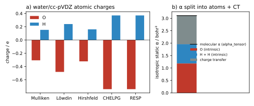

# 27.2 Electrostatic features and atomic charges

<!-- section: 27.2; status: gap; registry: none; theory: none -->

The electrostatic features are the cheapest outputs that still carry real
information about the density: the potential and field at each nucleus, the
potential on a molecular surface, the low multipoles and five kinds of atomic
charge. All of them are functions of the reference density
$D = 2C_oC_o^{\mathsf T}$ and nothing else. No crate `theory.md` covers them
yet, so this section is the reference, read from the loops in
`crates/ferric-scf/src/properties.rs`.

| Quantity | Rust | Python |
|---|---|---|
| ESP at nuclei | `ferric-scf/src/properties.rs::esp_at_atoms` | `esp_at_atoms(result)` |
| ESP at points | `ferric-scf/src/properties.rs::esp_at_points` | `esp_at_points(result, points_bohr)` |
| Surface ESP | `ferric-scf/src/properties.rs::esp_on_surface` | NPZ `esp_surface` |
| Field at nuclei | `ferric-scf/src/properties.rs::electric_field_at_atoms` | NPZ `electric_field` |
| Dipole | `ferric-scf/src/properties.rs::dipole_moment` | NPZ `dipole` |
| Löwdin, Mulliken | `ferric-scf/src/properties.rs::{lowdin_charges,mulliken_charges}` | `lowdin_charges`, `mulliken_charges` |
| Hirshfeld | `ferric-scf/src/properties/hirshfeld_grid.rs::hirshfeld_charges` | `hirshfeld_charges` |
| CHELPG, RESP | `ferric-scf/src/properties.rs::{chelpg_charges,resp_charges,chelpg_and_resp_charges}` | `chelpg_charges`, `resp_charges` |

The Python functions take an `RhfResult` or `DftResult`. Mulliken, Löwdin,
CHELPG and RESP are documented as closed-shell only.

## 27.2.1 Potential and field at the nuclei

The ESP at nucleus $A$ leaves out $A$'s own nuclear term, which is infinite:

$$ V(\mathbf R_A) = \sum_{B\neq A}\frac{Z_B}{\lvert\mathbf R_A-\mathbf R_B\rvert} - \sum_{\mu\nu} D_{\mu\nu}\,\Big\langle\mu\Big\lvert\frac{1}{\lvert\mathbf r-\mathbf R_A\rvert}\Big\rvert\nu\Big\rangle . \tag{27.1} $$

The electronic integral is libint2's nuclear-attraction operator with a unit
probe charge at $\mathbf R_A$. The field is the negative gradient of the same
potential, also without the self term:

$$ \mathbf E(\mathbf R_A) = \sum_{B\neq A} Z_B\frac{\mathbf R_A-\mathbf R_B}{\lvert\mathbf R_A-\mathbf R_B\rvert^3} - \sum_{\mu\nu} D_{\mu\nu}\,\Big\langle\mu\Big\lvert\frac{\mathbf R_A-\mathbf r}{\lvert\mathbf r-\mathbf R_A\rvert^3}\Big\rvert\nu\Big\rangle . \tag{27.2} $$

Both are exact functions of $D$: no grid and no fit. $V(\mathbf R_A)$ is a
rotation- and translation-invariant scalar per atom, and $\mathbf E$ is a
vector per atom. Two coincident atoms are an error, not an infinity.

## 27.2.2 Potential at arbitrary points and on a surface

At a point $\mathbf r_g$ that is not a nucleus, the full potential is

$$ V(\mathbf r_g) = \sum_{A}\frac{Z_A}{\lvert\mathbf r_g-\mathbf R_A\rvert} - \sum_{\mu\nu} D_{\mu\nu}\,\Big\langle\mu\Big\lvert\frac{1}{\lvert\mathbf r-\mathbf r_g\rvert}\Big\rvert\nu\Big\rangle , \tag{27.3} $$

with every nucleus included. `esp_at_points` takes the points in **Bohr**.

The NPZ surface (`compute_esp_surface = true`) puts a Lebedev sphere on each
atom at `esp_surface_vdw_scale` × the Bondi radius
(`ferric-pcm/src/radii.rs::bondi_radius_bohr`) and drops the points that fall
inside another atom's scaled sphere. The defaults are a scale of 1.4 and 110
angular points.

The Lebedev spheres have a fixed orientation in the lab frame. Rotating the
molecule therefore changes the point set, not just its coordinates: the values
at corresponding points are not available after a rotation. Store
`esp_points` with `esp_surface` (the writer refuses one without the other) and
treat the pair as a point cloud, not as a fixed-length vector.

## 27.2.3 Multipoles and orbital moments

| Key | Definition | Note |
|---|---|---|
| `dipole` | $\boldsymbol\mu = \sum_A Z^{\mathrm{eff}}_A\mathbf R_A - \sum D_{\mu\nu}\langle\mu\lvert\mathbf r\rvert\nu\rangle$ | origin $(0,0,0)$; origin-dependent when the molecule is charged |
| `density_second_moment` | $M_{cd} = \sum D_{\mu\nu}\langle\mu\lvert r_c r_d\rvert\nu\rangle$ | electronic only, about the origin; translation changes it |
| `orbital_centers` | $\langle\phi_p\lvert\mathbf r\rvert\phi_p\rangle$ | every retained MO, restricted references only |
| `orbital_spreads` | $\sqrt{\max(0,\langle r^2\rangle_p-\lvert\langle\mathbf r\rangle_p\rvert^2)}$ | canonical MOs, so delocalized; restricted only |

The dipole is the only property in this section that uses the ECP-reduced
nuclear charge $Z^{\mathrm{eff}}_A = Z_A - n^{\mathrm{core}}_A$.

## 27.2.4 Five charge schemes

| Scheme | Definition | Depends on |
|---|---|---|
| Mulliken | $q_A = Z_A - \sum_{\mu\in A}(DS)_{\mu\mu}$ (27.5) | basis; unstable with diffuse functions |
| Löwdin | $q_A = Z_A - \sum_{\mu\in A}(S^{1/2}DS^{1/2})_{\mu\mu}$ (27.4) | basis, less strongly |
| Hirshfeld | $q_A = Z_A - s\!\int w_A\rho$, $w_A = \rho^0_A/(\sum_B\rho^0_B + 10^{-12})$ (27.6) | proatoms, grid |
| CHELPG | least-squares fit of point charges to $V(\mathbf r_g)$, $\sum_A q_A = $ molecular charge (27.7) | point lattice |
| RESP | CHELPG plus a hyperbolic restraint on non-H charges | point lattice, restraint |

**Löwdin** forms $S^{1/2}$ from the eigendecomposition of $S$ and errors if an
eigenvalue is not positive.

**Hirshfeld** integrates on the flat 75 × 110 Becke–Lebedev grid
(`AtomicGridConfig::default()`). The proatom densities $\rho^0_A$ come from a
neutral free-atom SCF in the same basis, the default of both the CLI and
Python; `proatom="slater"` selects a single-Slater model instead, and the code
also falls back to it, with a warning, when the free-atom SCF fails. The
factor $s = N_e/\sum_A\!\int w_A\rho$ rescales the integrated populations to
the exact electron count, so $\sum_A q_A$ equals the molecular charge by
construction and the grid error goes into the individual charges only.

**CHELPG** builds a cubic lattice in the lab frame, spacing 0.3 Bohr, extending
2.8 Bohr beyond the molecule. It keeps a point if it lies outside every atom's
Bondi radius and within 2.8 Bohr of some atom's radius. The charges solve the
bordered normal equations

$$ \begin{pmatrix} A & \mathbf 1\\ \mathbf 1^{\mathsf T} & 0\end{pmatrix}\begin{pmatrix}\mathbf q\\ \lambda\end{pmatrix} = \begin{pmatrix}\mathbf b\\ Q\end{pmatrix}, \qquad A_{AB} = \sum_g \frac{1}{r_{gA}r_{gB}},\quad b_A = \sum_g \frac{V(\mathbf r_g)}{r_{gA}} , \tag{27.7} $$

with $Q$ the molecular charge. The environment variables
`FERRIC_CHELPG_SPACING`, `FERRIC_CHELPG_MARGIN`, `FERRIC_CHELPG_VDW_SCALE` and
`FERRIC_CHELPG_OUTER_CUTOFF` override the four lattice parameters. A dataset
must record them if it sets them; the certificate does not.

**RESP** adds the single-stage hyperbolic restraint
$a\sum_{A\notin\mathrm H}(\sqrt{q_A^2+b^2}-b)$ with $a = 0.0005$ and
$b = 0.1\,e$ (`FERRIC_RESP_RESTRAINT_WEIGHT`, `FERRIC_RESP_RESTRAINT_B`)
and solves by fixed-point iteration: each pass adds
$a/\sqrt{q_A^2+b^2}$ to the diagonal of the bordered matrix of (27.7) at
the previous charges. It is not two-stage or
multi-conformer RESP. When both are requested, CHELPG and RESP share one
lattice and one set of ESP values.

Because the lattice is fixed in the lab frame, CHELPG and RESP charges move
slightly when the molecule is rotated. Mulliken is invariant under rotation.
Löwdin is invariant for spherical-harmonic (`pure`) shells; Cartesian
d shells transform non-orthogonally and need not leave it unchanged.
Hirshfeld is invariant up to the error of its atom-centred grid; a committed
test holds symmetry-equivalent atoms equal, and the charges unchanged under
translation, to below $10^{-3}\,e$
(`ferric-rpa/tests/hirshfeld_symmetry.rs::equivalent_atoms_are_equal_in_a_rotated_frame`,
`ferric-rpa/tests/hirshfeld_symmetry.rs::charges_are_invariant_to_translation`).

*Figure 27.1. Water/cc-pVDZ: (a) O and H charges in the five schemes;
(b) the isotropic static α as $\sum_A\alpha^A$ plus $\alpha_{\mathrm{CT}}$
(section 27.3). Made by `book/src/figures/27-ml/charges_and_alpha.py`.*

The spread in panel (a) is the point: the five numbers are different
definitions, not five estimates of one quantity. Pick one scheme for a
dataset and record which.

## 27.2.5 How well these are checked

| Quantity | Check | Agreement | Test |
|---|---|---|---|
| ESP at nuclei | PySCF `int1e_rinv` on PySCF's density | 4.8e-14 a.u. same density; 4.6e-9 own SCF | `ferric-scf/tests/validation_density_properties.rs::density_properties_h2o_vs_pyscf` |
| Field at nuclei | PySCF `int1e_iprinv`, same density | 1.5e-13 a.u.; 2.7e-9 own SCF | the same file |
| Hirshfeld charges | numpy on ferric's grid with PySCF density and proatoms | 1.9e-13 $e$ same density; 2.6e-9 $e$ own SCF; default grid within 2.0e-4 $e$ of a dense grid | `crates/ferric-rpa/tests/validation_hirshfeld.rs` |
| All NPZ keys | PySCF integrals contracted with the exported density | integral level ≤ 2.8e-14; property chain ≤ 5.9e-10 | `crates/ferric-cli/tests/validation_npz.rs` |

The figures are from `site/src/reference/validation.md`, "Anchors". The
CHELPG and RESP checks in `validation_npz.rs` are invariants only: the charges
sum to the molecular charge, respect the mirror symmetry of water, and
reproduce the surface ESP they were fitted to. No external code supplies a
reference value for them.

## 27.2.6 Known limits (2026-11-15)

- **Bare nuclear charges.** `esp_at_atoms`, `electric_field_at_atoms`,
  `esp_at_points`, `becke_charges`, `lowdin_charges`, `mulliken_charges` and
  `hirshfeld_charges` use the bare $Z_A$, where `dipole_moment` uses
  $Z^{\mathrm{eff}}_A$. On an atom with an ECP, each charge is off by the
  number of core electrons the ECP removed, and the ESP and field contain the
  full nuclear charge without the core electrons that screen it. A ghost atom
  contributes a nucleus it should not have. None of these functions checks for
  either case. Until this is fixed, do not use them on ECP or ghost-atom
  systems.
- CHELPG and RESP charges depend on molecular orientation (27.2.4).
- The surface-ESP point set depends on orientation (27.2.2).

## Sources

| Source | Used for |
|---|---|
| `crates/ferric-scf/src/properties.rs` | eqs. 27.1–27.5, 27.7, the lattice and restraint parameters, the bare-$Z$ finding |
| `crates/ferric-scf/src/properties/hirshfeld_grid.rs` | eq. 27.6, the grid, the proatoms and the rescaling |
| `crates/ferric-pcm/src/radii.rs` | the Bondi radii |
| `crates/ferric-python/ferric.pyi` | the Python names and argument units |
| `site/src/reference/validation.md` | the agreement figures in 27.2.5 |

Changes from the sources: none; there is no theory text to change.
